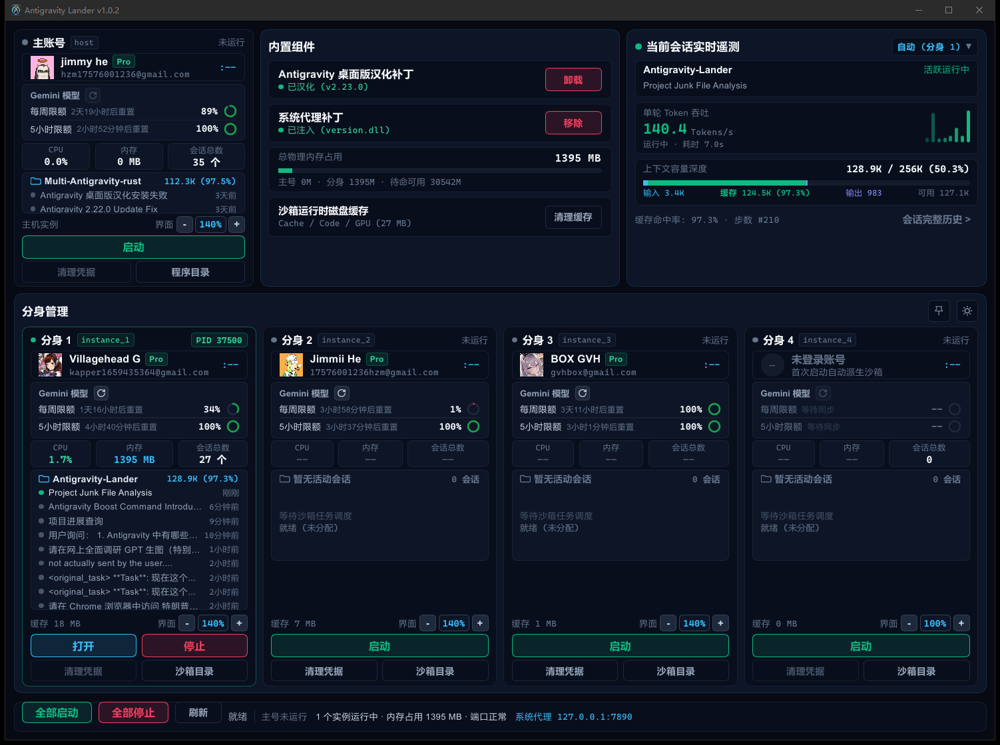

<div align="center">


# Antigravity Lander

**Antigravity 实例调度与遥测中枢**

[](https://github.com/GVHBOX/Antigravity-Lander/actions/workflows/ci.yml)
[](LICENSE)
[](https://github.com/GVHBOX/Antigravity-Lander)
[](https://www.rust-lang.org/)
[](https://slint.dev/)

<br/>



</div>

---

## 功能

- **多账号分身隔离**：支持主账号与最多 4 个独立沙箱分身并行运行。账号登录态与缓存保存在 `data/instance_1` ~ `instance_4` 目录中，各实例互不冲突。
- **系统代理补丁**：内置代理注入模块，使 Antigravity 流量走本机系统代理（默认 `127.0.0.1:7890`）。
- **桌面版汉化补丁**：内置桌面版中文补丁包，支持一键应用或卸载。
- **会话遥测中枢**：实时采集活跃会话遥测数据，包括单轮 Token 吞吐率（Tokens/s）、256K 上下文容量深度（输入/缓存/输出）、缓存命中率与推理步数。
- **配额监视**：图形化展示主账号与各分身的 Gemini 模型每周限额与 5 小时限额百分比及重置时间。
- **界面调节**：支持 80%~200% 界面缩放调节，启动时通过 `--force-device-scale-factor` 注入，适配高分屏。

---

## 快速开始

### 方式一：直接下载运行（推荐）

前往 [GitHub Releases](https://github.com/GVHBOX/Antigravity-Lander/releases) 下载最新版本的 `Antigravity-Lander-v1.0.3-windows-x64.zip` 或 `Antigravity-Lander.exe`，解压后双击即可运行。

> 运行环境要求：Windows 10 / 11 64位系统。运行前确认已安装官方 Google Antigravity 客户端（默认路径为 `AppData\Local\Programs\antigravity`）。

### 方式二：源码构建

需要 Rust 1.85+（2024 Edition）与 MSVC 构建环境：

```powershell
cargo build --release
```

编译产物位于 `target\release\antigravity-lander.exe`，复制至根目录重命名为 `Antigravity-Lander.exe`。

---

## 常见问题（FAQ）

**Q：需要先退出正在运行的主号吗？**  
不需要。主号与分身彼此完全独立，主号使用中可直接启动分身。

**Q：分身的数据保存在哪里？**  
保存在程序所在目录的 `data/` 文件夹下。备份、迁移或重置分身数据，直接操作该文件夹即可。

**Q：会泄露账号凭据或上传隐私数据吗？**  
不会。分身直接连接 Google 官方服务器，本工具不架设网络中转，所有登录凭据仅保存在本机的 `data/` 目录中，不收集也不上传任何数据。

**Q：启动后没有弹出窗口？**  
确认电脑上已安装官方 Google Antigravity 客户端（默认路径为 `AppData\Local\Programs\antigravity`）。

---

## 开源协议

本项目采用 [MIT License](LICENSE) 开源。
